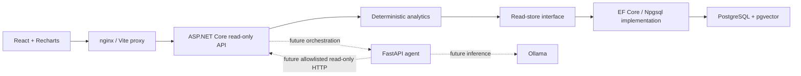

# Architecture — Phase 2

The browser calls only same-origin `/api` endpoints. nginx proxies to the API in Compose; Vite proxies to localhost:8080 during development. No browser/agent database access exists. Only .NET receives database credentials. Agent and Ollama retain independent liveness and are unused by deterministic analytics.

## Backend boundaries

- `Manufacturing.Domain`: six production entities, inspection/machine enums; no infrastructure dependencies.
- `Manufacturing.Application`: window validation, read DTOs/store contract, deterministic FPY/defect/trend calculations and service orchestration. No EF, HTTP or LLM dependency.
- `Manufacturing.Infrastructure`: EF model/migration, composite relational constraints, indexed no-tracking window queries, raw health check and transactional synthetic seeding.
- `Manufacturing.Api`: composition root, thin GET routes, query validation, ProblemDetails and JSON logging. Startup migration/seeding is opt-in configuration, enabled by Compose for the demo.
- `Manufacturing.Api.Tests`: pure calculations, in-process health HTTP tests and real PostgreSQL-backed HTTP/constraint/migration tests using an isolated temporary database.

All request data access is read-only. Schema changes and seed inserts occur solely during configured initialization, not through REST endpoints. No generic SQL, shell, write or equipment-control tools are exposed. Time/line filtering executes in SQL, and first-pass analytics execute in .NET. The maximum API window is seven days. This is a small demonstration dataset: quality records are materialized per request; production-scale server-side aggregation/pagination is outside this phase.

The German dashboard shows actual API counts, distinct whole-window and final-hour FPY, SPI measurements, a Recharts trend, primary AOI defect distribution, alarm source IDs and expandable batch evidence. Requests share a line and UTC window, cancel when filters change, reject partial dashboard loads and ignore late responses. Empty samples show unavailable FPY. All observation text avoids causal claims. No production measurements are embedded in frontend source.

## Runtime and configuration

All five services have health checks. Compose waits for PostgreSQL before starting .NET and for API health before nginx. Schema migration and seed completion precede HTTP startup. Agent health and Ollama model listing do not require a model. Service ports bind to loopback; PostgreSQL and Ollama have no published application ports. A separate optional Compose file exposes an isolated test database only on loopback.

Credentials come from ignored `.env` or environment variables. Startup flags are `Database__ApplyMigrations` and `Demo__SeedOnStartup`. `ConnectionStrings__Postgres` is required. Raw database exception details are logged server-side; API failures are sanitized. FastAPI emits JSON logs as in Phase 1.

.NET 10 LTS, SDK/container releases, direct packages, EF CLI tools and the Recharts version are pinned. JavaScript/Python lockfiles pin transitive dependencies. The EF model snapshot and migration are versioned schema artifacts. No generated build or browser artifacts are committed.

See [production API and counting rules](production-api.md) for the domain, exact synthetic scenario, contracts, migration commands and database test setup.

## Later phases

AI diagnosis, evidence retrieval, authentication/TLS and production hardening remain unimplemented. Future agent tools must remain allowlisted/read-only, treat retrieved documents as untrusted input, cite evidence/time ranges and separate facts, hypotheses and recommendations. No manufacturing equipment integration is planned for this demonstration.
