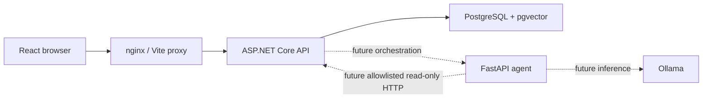

# Architecture — Phase 1

The only browser data endpoint is the .NET API. No CORS policy is needed because both production nginx and the development Vite server proxy `/api`. Only .NET receives database credentials. Agent URLs are configured for later phases but are unused by the health endpoint. The agent has no SQL, shell, write, or equipment-control tools.

## Backend boundaries

- `Manufacturing.Domain`: reserved for production entities and domain rules; no external dependencies.
- `Manufacturing.Application`: references Domain; reserved for use cases and read-only contracts.
- `Manufacturing.Infrastructure`: references Application; owns PostgreSQL connectivity and readiness implementation.
- `Manufacturing.Api`: composition root, sanitized health response, exception handling, JSON logging.
- `Manufacturing.Api.Tests`: in-process HTTP integration tests with a replaced dependency check covering healthy and unavailable states.

The empty Domain/Application libraries deliberately avoid speculative business abstractions. Phase 2 adds EF Core, migrations, domain tables, deterministic first-pass analytics, and a reproducible synthetic scenario using a fixed date. No production measurements are fabricated in Phase 1. Future FPY calculations must use unique units' first inspection results and exclude reinspection double counting.

## Health and configuration

API readiness executes `SELECT 1` with five-second connection/command timeouts. Failure details are retained by the health system for server-side diagnostics but not exposed in HTTP responses. FastAPI health is independent liveness. Compose orders PostgreSQL → backend → frontend. Agent and Ollama start independently. No model pull occurs during build or startup.

Database credentials come from ignored `.env` files or environment variables, with required-value validation in Compose and fail-fast connection configuration in .NET. Use hex passwords to avoid connection-string quoting issues. The initialization SQL enables pgvector on a new persistent volume. It is infrastructure bootstrap, not a domain schema migration.

## Dependency choices

.NET 10 is the current LTS line (support through November 2028). The SDK is pinned in `global.json`; containers and direct NuGet dependencies use explicit versions. Npgsql provides the smallest database readiness slice; EF Core is deferred until there is a domain schema. The API runtime image stays on the same .NET 10 line.

React, TypeScript, and Vite provide the browser slice, with Vitest and Testing Library for user-visible success/failure tests. Recharts is deferred until there are measurements to chart. Python 3.12 and FastAPI provide typed health output, with uv's committed lockfile and frozen synchronization for reproducible installs. LangGraph is deferred until diagnosis orchestration is needed. PostgreSQL 17 with pgvector 0.8.2 provides vector capability without creating embeddings. Ollama is present but has no model dependency. Package lockfiles pin transitive JavaScript and Python dependencies; Docker tags pin release versions rather than floating `latest` tags.

## Limits

This is a local demonstration, without authentication, TLS, production hardening, AI diagnosis, document retrieval, manufacturing data, or equipment integration. Those concerns belong to later phases. Diagnostic conclusions will require evidence references and time ranges, distinguish facts/hypotheses/recommendations, and treat retrieved text as untrusted input.
