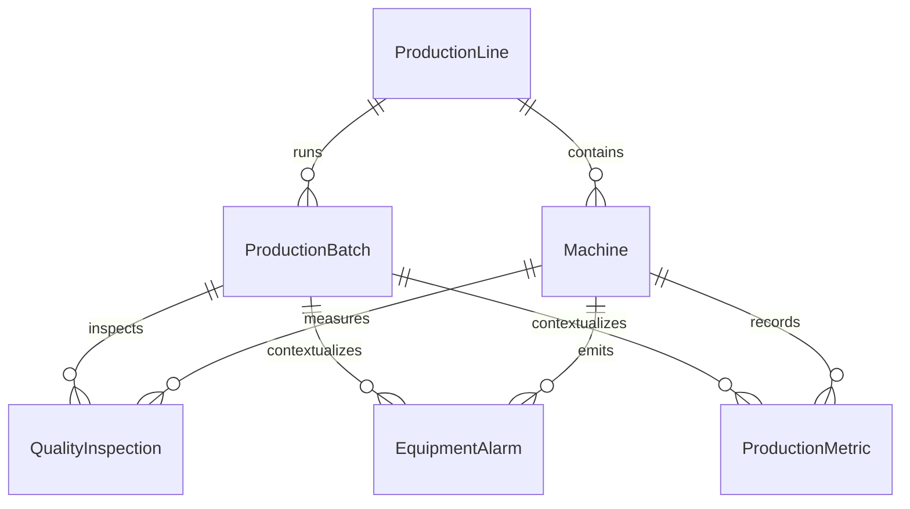

# Production data and analytics API — Phase 2

All records are synthetic. Demo date: **2026-10-15**. Default window: **06:00–12:00 UTC**. The dataset is generated without current timestamps or randomness. No AI, root-cause inference, or equipment control is implemented.

## Model and relationships



`QualityInspection` identifies a unit by `(ProductionBatchId, UnitSerial)`. `Stage` is SPI or final AOI; `Attempt` starts at 1. A unique index on `(batch, serial, stage, attempt)` rejects duplicate ingestion. Composite foreign keys enforce that batches, machines, inspections, alarms and raw metrics belong to the same line. Each line has an SPI station, placement machine, and final AOI station. Machine M03 is the placement machine on Line 3. Codes are unique; dates and positive quantities have database constraints.

SPI stores paste volume (% of nominal), paste height (µm), and paste area (% of nominal). Synthetic accepted SPI volume is 98–102%; anomalous volume is 135–145% (the demonstration volume acceptance band is 75–125%). AOI stores accepted/rejected status and one primary defect code. It does not invent a numeric solder measurement. A rejected inspection has one primary defect; accepted inspections have none. Secondary/multiple defects per unit are outside this slice.

`ProductionMetric` stores an equipment cycle-time sample per hourly batch in seconds, not an FPY aggregate. `EquipmentAlarm` references the machine and active batch, with occurrence time, code, severity, and message.

## FPY definition

FPY (%) = 100 × **first-pass accepted eligible units / eligible units**.

1. Eligibility requires an explicit **attempt 1 at the final AOI stage**. Units without final AOI attempt 1 are excluded, including units with only SPI or only a reinspection.
2. The unit's identity is **batch + serial**. The same serial in another batch is a different unit.
3. The attempt-1 AOI timestamp determines the time window. Passing reinspection never repairs the first-pass numerator and never moves eligibility to a later window.
4. Duplicate ingestion is rejected by PostgreSQL. The deterministic analytics function also defensively deduplicates input before filtering the window, ordered by timestamp then record ID. If conflicting duplicate records are supplied to the pure function, the earliest timestamp/ID wins.
5. Both accepted and rejected first AOI results count in the denominator. Planned quantities and SPI inspections are not added to it.
6. With no eligible units, FPY is `null`, never 0 or NaN. The API rounds percentages to four decimal places; the UI formats two decimals. Overall FPY uses sums of accepted/eligible units, never the unweighted average of hourly percentages.

SPI anomaly rate uses independently counted SPI attempt-1 units with `Accepted=false`. It is not an AOI FPY component. Paste volume statistics derive from those same SPI first-pass records. All stages use their own inspection timestamps; an arbitrary short window can therefore contain different AOI and SPI populations.

Defects count the primary codes of rejected first-pass results, grouped separately by SPI/AOI. Reinspections do not inflate distributions. The AOI defect total equals eligible AOI units minus first-pass accepted units for the same line/window.

## Reproducible scenario

Each line has six hourly batches of 1,000 units of `CTRL-PCB-A`. Unit serials deliberately repeat across batches to exercise batch-scoped identity. Failed first AOI inspections have passing attempt-2 records 15 minutes later, which do not improve FPY. Fixed IDs and timestamps make fresh seeding reproducible.

| Hour UTC | Line 3 FPY | AOI rejected | SPI anomalous | M03 nozzle alarms |
| --- | ---: | ---: | ---: | ---: |
| 06:00 | 98.5% | 15 | 20 | 1 |
| 07:00 | 97.6% | 24 | 35 | 1 |
| 08:00 | 96.8% | 32 | 50 | 2 |
| 09:00 | 95.9% | 41 | 65 | 3 |
| 10:00 | 95.0% | 50 | 80 | 4 |
| 11:00 | 94.2% | 58 | 100 | 5 |

Line 3 totals: **5,780 / 6,000 = 96.3333% FPY**, 220 primary AOI defects, 350 SPI anomalous units, and 16 nozzle alarms. The final hourly value is **94.2%**, distinct from the overall FPY. Both solder bridge and insufficient-solder observations increase. Lines 1 and 2 provide stable comparisons at 99.0% and 98.8% FPY respectively. There are 18 batches, 9 machines, 18 raw cycle samples, 17 alarms and **36,352 inspection records** across all lines (including 352 reinspections).

These are deliberately correlated synthetic observations. Time alignment is evidence of co-occurrence, **not a proven causal chain**. No root cause is asserted.

## Read-only HTTP contract

| GET endpoint | Response |
| --- | --- |
| `/api/lines` | Demo date, scenario line ID, default UTC window, available lines |
| `/api/lines/{id}/metrics` | Eligible/accepted counts, overall FPY, SPI counts/rate, paste volume mean/max, alarm count, mean raw cycle time |
| `/api/lines/{id}/quality-trend` | Hourly UTC buckets with AOI counts/FPY and SPI counts |
| `/api/lines/{id}/alarms` | Ordered alarm records with source IDs, machine and batch codes |
| `/api/lines/{id}/defects` | Primary defect distribution, separated by stage |
| `/api/lines/{id}/batches` | Overlapping batches with product IDs, production timestamps and window-scoped AOI counts/FPY |

All five line-scoped routes accept optional `from` and `to` query parameters in ISO 8601 with an explicit offset, for example `2026-10-15T06:00:00Z`. A missing bound uses the corresponding demo default, not the current date. Offset timestamps are normalized to UTC. Percent-encode `+` as `%2B` when using nonzero offsets in query strings.

The interval is **[from, to)**, with `from < to` and maximum duration 7 days. Each response includes `lineId`, the normalized `window`, a relative `source` URL and `data`. Both predicates are applied in SQL before materialization. Domain calculations are deterministic .NET code, separated from persistence and any future LLM.

Trend points start at UTC hour boundaries, including partial first/last hours. Only records inside the requested interval count. Empty buckets have zero counts and `null` FPY; charts leave missing FPY gaps. Batch lists use time overlap (`started < to && completed > from`); their accepted/eligible counters still use the selected inspection window, not the entire batch lifetime.

Invalid/missing-offset timestamps, reversed/equal bounds and windows longer than 7 days return **400 ValidationProblemDetails**. An unknown line returns **404 ProblemDetails**. A valid empty window returns **200** with null rates and empty record lists. Database unavailability returns **503** with a sanitized ProblemDetails body; server-side logs retain diagnostic details. Mutating routes are not registered (POST to an analytics route returns 405).

```bash
curl --fail 'http://localhost:8080/api/lines'
curl --fail 'http://localhost:8080/api/lines/3/metrics?from=2026-10-15T06:00:00Z&to=2026-10-15T07:00:00Z'
curl --fail 'http://localhost:5173/api/lines/3/quality-trend'
python3 scripts/smoke-api.py
```

## Schema lifecycle

`InitialProductionSchema` and its EF model snapshot are checked in. The migration also enables pgvector; it works on a new database or the existing Phase 1 volume. Compose explicitly enables `Database__ApplyMigrations=true` and `Demo__SeedOnStartup=true`. Both default to false outside Compose. Seeding requires migrations to be enabled.

The seed runs in one transaction under a fixed PostgreSQL advisory lock. A completed seed is recognized by its final Line 3 batch; repeated startup leaves existing records unchanged. Interrupted transactions roll back. A populated, unrecognized domain database is rejected instead of silently mixed with synthetic data. This is not a repair/import mechanism for edited datasets; reset a disposable demo volume to regenerate the scenario.

For externally managed schemas, disable both startup flags and apply reviewed migrations separately. Runtime startup migrations are a convenience for this single demo deployment. [EF Core migration guidance](https://learn.microsoft.com/en-us/ef/core/managing-schemas/migrations/applying?tabs=dotnet-core-cli) describes the tradeoffs.

```bash
dotnet tool restore
dotnet ef migrations list --no-connect --project backend/src/Manufacturing.Infrastructure --startup-project backend/src/Manufacturing.Api
# Generate a reviewable deployment script; no database connection is required:
dotnet ef migrations script --idempotent --project backend/src/Manufacturing.Infrastructure --startup-project backend/src/Manufacturing.Api --output /tmp/manufacturing-migrations.sql
# After setting ConnectionStrings__Postgres for the intended database:
dotnet ef database update --project backend/src/Manufacturing.Infrastructure --startup-project backend/src/Manufacturing.Api
```

EF Core and EF tools are pinned to 10.0.14; Npgsql's EF provider is pinned to 10.0.3. The explicit EF Relational pin keeps runtime, design tooling and test host on the same patch. See [Npgsql 10 release notes](https://www.npgsql.org/efcore/release-notes/10.0.html). Recharts 3.10.1 is pinned and lazy-loaded for the interactive trend chart. No AI dependencies or model downloads are added.

## Tests

Pure tests cover FPY, duplicates, repeated serials across batches, missing attempt 1, half-open windows, reinspection eligibility, empty samples and invalid ranges. PostgreSQL integration tests create a uniquely named temporary database, apply real migrations, seed records, exercise all HTTP endpoints and verify database constraints and repeated seeding. They drop only their own temporary database during fixture cleanup.

Set `TEST_POSTGRES_CONNECTION` to a disposable PostgreSQL superuser/admin connection with CREATE DATABASE and vector extension privileges. Without it, database tests are explicitly skipped; unit and health tests still run. CI supplies a dedicated pgvector PostgreSQL service so integration tests execute there. Local setup:

```bash
docker compose --env-file .env -f compose.test.yaml up -d --wait
# Use the password configured for this test container, with connection-string quoting if needed:
export TEST_POSTGRES_CONNECTION='Host=localhost;Port=55432;Database=postgres;Username=manufacturing_test;Password=<your-test-password>'
dotnet test backend/Manufacturing.slnx --configuration Release
docker compose -f compose.test.yaml down
```

`TEST_POSTGRES_PORT` can override the local test port. Never point this fixture at a production database. Frontend tests cover API-derived rendering, line changes, shared UTC filters, empty/error states, retries and stale-response isolation. The Compose smoke script checks the running application through the frontend proxy. Browser verification uses Playwright CLI.
